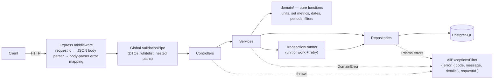

# Everfit Workout Logging API

Coaches log their clients' workouts and track progress: bulk workout logging with unit
normalization, filterable/paginated history, and personal records (max weight, max volume,
Epley 1RM) with period comparison ("PR this month vs last month").

**Stack:** NestJS 11 · TypeScript (strict) · PostgreSQL 16 · Prisma 6 · Jest + supertest · Docker

| Doc | What's in it |
|---|---|
| [`docs/performance.md`](docs/performance.md) | 60k-entry benchmark, `EXPLAIN ANALYZE`, HTTP latencies |
| [`AI_WORKFLOW.md`](AI_WORKFLOW.md) | How AI was used, what it got wrong, what was rejected |
| [`docs/reviews/`](docs/reviews) | Independent AI code reviews per milestone and how each finding was handled |
| [`ESTIMATION.md`](ESTIMATION.md) | Estimate made before starting vs actual time |
| [`CLAUDE.md`](CLAUDE.md) | Project rules given to AI assistants |

---

## Quick start

```bash
docker compose up --build
```

- API: http://localhost:3000/api/v1 · Swagger UI: http://localhost:3000/docs · Health: http://localhost:3000/health
- Migrations run on start; the exercise catalog (`config/exercise-catalog.json`) is synced on boot.
- Postgres is exposed on host port **5434** (5432 is often taken by a local install).

```bash
curl -X POST localhost:3000/api/v1/users/client-42/workouts \
  -H 'Content-Type: application/json' -H 'Idempotency-Key: demo-1' \
  -d '{"timezone":"Asia/Ho_Chi_Minh","entries":[{"date":"2026-10-13","exerciseName":"Bench Press",
       "sets":[{"reps":5,"weight":100,"unit":"kg"},{"reps":3,"weight":235,"unit":"lb"}]}]}'
curl 'localhost:3000/api/v1/users/client-42/personal-records?exercise=bench%20press&unit=lb'
```

### Local development

```bash
npm ci                     # also generates the Prisma client
cp .env.example .env
npm run db:up              # Postgres only (port 5434)
npm run db:deploy          # apply migrations
npm run start:dev

npm run lint && npm run typecheck
npm test                   # unit tests (no DB)
npm run db:test:up && npm run test:e2e   # e2e against a throwaway Postgres (port 5433, tmpfs)
```

Environment variables (validated at boot — the app refuses to start on bad config):
`DATABASE_URL` (required), `PORT` (3000), `NODE_ENV`, `LOG_LEVEL` (info), `SLOW_QUERY_MS` (200),
`EXERCISE_CATALOG_PATH` (config/exercise-catalog.json).

---

## Architecture



**Modules:** `workouts` (log + history) · `personal-records` (records + compare) · `exercises`
(catalog sync, name/muscle-group lookup) · `idempotency` · `units` (registry, conversion,
presentation — pure) · `health`.

**Layering rules** (enforced by ESLint where possible, see `CLAUDE.md`):

| Layer | Responsibility | May import |
|---|---|---|
| Controller | HTTP only: DTO in, response out | services, decorators |
| Service | Orchestration, business rules, transaction boundary | repositories, domain, `TransactionRunner` |
| Repository | **Only** place that talks to Prisma / SQL | Prisma |
| `modules/*/domain`, `common/utils`, `common/errors` | Pure functions, unit-tested without Nest/DB | **no** `@nestjs/*`, **no** `@prisma/*` (lint error) |

Reusable code placement: pure & generic → `common/utils` · needs infra → `common/helpers` ·
request-level reuse → `common/decorators`, `common/pipes` · must run before Nest (request id,
body-parser errors) → `common/middleware` · business formulas → `modules/<feature>/domain`.

```
src/
├── common/        decorators · errors · filters · helpers · middleware · pipes · utils
├── config/        typed config + fail-fast env validation
├── infrastructure/ logger (pino, request id) · prisma (client, TransactionRunner)
├── modules/
│   ├── exercises/        catalog sync, lookups, GET /exercises
│   ├── idempotency/      claim/replay of Idempotency-Key
│   ├── personal-records/ domain/{period, comparison}, repository (UNION ALL), mapper
│   ├── units/            domain/{registry, conversion, presentation}, @IsWeightUnit
│   └── workouts/         domain/{set-metrics, prepare-entries, history-filters, present-set}
└── health/
```

---

## API

Base path `/api/v1`. No authentication (by spec): `userId` is a path parameter
(`^[A-Za-z0-9_-]{1,64}$`). Full schemas in Swagger at `/docs`.

| Method | Path | Purpose |
|---|---|---|
| `POST` | `/users/:userId/workouts` | Log 1–100 entries (1–50 sets each), atomically |
| `GET` | `/users/:userId/workouts` | History: filters, keyset pagination, unit output |
| `GET` | `/users/:userId/personal-records` | Max weight / max volume / best Epley 1RM for an exercise |
| `GET` | `/users/:userId/personal-records/compare` | Records in this period vs the previous one |
| `GET` | `/exercises` | Exercise catalog with muscle groups |
| `GET` | `/health` (no prefix) | Liveness + database check |

### `POST /users/:userId/workouts`

```jsonc
// Request (header Idempotency-Key is optional)
{
  "timezone": "Asia/Ho_Chi_Minh",          // optional IANA zone, default UTC
  "entries": [
    { "date": "2026-10-13",                // date, local date-time, or date-time with offset
      "exerciseName": "Bench Press",       // case/space-insensitive; unknown names are created
      "sets": [ { "reps": 5, "weight": 100, "unit": "kg" },
                { "reps": 3, "weight": 235, "unit": "lb" } ] }
  ]
}
// 201 Created
{ "data": [ {
  "id": "828b56a5-…", "exerciseId": "9db93b1a-…", "exerciseName": "Bench Press",
  "performedAt": "2026-10-12T17:00:00.000Z", "timezone": "Asia/Ho_Chi_Minh",
  "sets": [
    { "setIndex": 0, "reps": 5, "weight": 100, "unit": "kg", "weightKg": 100,    "volumeKg": 500,    "estimatedOneRepMaxKg": 116.67 },
    { "setIndex": 1, "reps": 3, "weight": 235, "unit": "lb", "weightKg": 106.59, "volumeKg": 319.78, "estimatedOneRepMaxKg": 117.25 }
  ] } ] }
```

Validation: `reps` integer 1–1000; `weight` 0–2000 with ≤ 3 decimals; `unit` from the registry;
`date` required, valid calendar date, not > 24 h in the future, not before 1900. One bad entry
rejects the whole batch (nothing is stored).

**Idempotency:** retrying with the same key and body returns the original response with
`Idempotent-Replayed: true` (even if the retries are concurrent); the same key with a different
body → `422 IDEMPOTENCY_KEY_REUSED`. Keys are scoped per user.

### `GET /users/:userId/workouts`

Query: `exercise` (partial, case-insensitive) · `muscleGroup` · `from` / `to` · `timezone` ·
`unit` (`kg`/`lb`; default = each set as logged) · `limit` (1–100, default 20) · `cursor`.

```jsonc
// GET /users/readme-demo/workouts?limit=1&unit=lb
{ "data": [ { "id": "828b56a5-…", "exerciseName": "Bench Press", "muscleGroups": ["chest","triceps","shoulders"],
    "performedAt": "2026-10-12T17:00:00.000Z", "timezone": "Asia/Ho_Chi_Minh",
    "sets": [ { "setIndex": 0, "reps": 5, "weight": 220.46, "unit": "lb", "volume": 1102.31, "estimatedOneRepMax": 257.21 },
              { "setIndex": 1, "reps": 3, "weight": 235,    "unit": "lb", "volume": 705,     "estimatedOneRepMax": 258.5 } ] } ],
  "pageInfo": { "limit": 1, "hasMore": true, "nextCursor": "eyJwIjoi…" } }
```

- Newest first. Pass `pageInfo.nextCursor` as `cursor` for the next page; a cursor reused with
  different filters is rejected (`INVALID_CURSOR`).
- A set shown in the unit it was logged in keeps its exact value (235 lb stays 235).
- No matches → `200` with `data: []` and `"message": "No workouts found for the given filters"`.

### `GET /users/:userId/personal-records`

Query: `exercise` (required, exact name, case/space-insensitive) · `from` / `to` · `timezone` · `unit` (default `kg`).

```jsonc
{ "exercise": { "id": "9db93b1a-…", "name": "Bench Press" }, "unit": "kg",
  "range": { "from": null, "to": null },
  "records": {
    "maxWeight":              { "value": 106.59, "achievedAt": "2026-10-12T17:00:00.000Z", "entryId": "…", "set": { "reps": 3, "weight": 106.59 } },
    "maxVolume":              { "value": 500,    "achievedAt": "2026-10-12T17:00:00.000Z", "entryId": "…", "set": { "reps": 5, "weight": 100 } },
    "bestEstimatedOneRepMax": { "value": 117.25, "achievedAt": "2026-10-12T17:00:00.000Z", "entryId": "…", "set": { "reps": 3, "weight": 106.59 } } } }
```

- Max weight = heaviest single set; max volume = highest `reps × weight` set; 1RM = Epley
  `weight × (1 + reps / 30)`, applied literally as specified (also for `reps = 1`).
- Ties report the **first** time the record was achieved.
- Unknown exercise → `404 NOT_FOUND`; known exercise without data in range → `200` with `null`
  records and a `message`.

### `GET /users/:userId/personal-records/compare`

Either `period=week|month` (+ optional `referenceDate`, default now) for calendar periods in the
client's `timezone` — ISO weeks start on Monday — or all four of
`currentFrom/currentTo/previousFrom/previousTo`.

```jsonc
// ?exercise=Bench Press&period=month&referenceDate=2026-10-14&timezone=Asia/Ho_Chi_Minh
{ "period": "month",
  "current":  { "from": "2026-09-30T17:00:00.000Z", "to": "2026-10-31T17:00:00.000Z", "records": { "maxWeight": { "value": 106.59, … }, … } },
  "previous": { "from": "2026-08-31T17:00:00.000Z", "to": "2026-09-30T17:00:00.000Z", "records": { "maxWeight": { "value": 95, … }, … } },
  "change": { "maxWeight": { "absolute": 11.59, "percent": 12.2 },
              "maxVolume": { "absolute": 25, "percent": 5.3 },
              "bestEstimatedOneRepMax": { "absolute": 6.42, "percent": 5.8 } } }
```

`change.<metric>` is `null` unless both periods have a record; `percent` is `null` when the
previous value is 0.

### Errors

Every error has the same shape; `requestId` matches the `X-Request-Id` response header and the logs.

```json
{ "error": { "code": "VALIDATION_ERROR", "message": "Request validation failed",
    "details": [ { "field": "entries[0].date", "issue": "date must be a string" },
                 { "field": "entries[0].sets[0].reps", "issue": "reps must not be less than 1" },
                 { "field": "entries[0].sets[0].unit", "issue": "unit must be one of: kg, lb" } ] },
  "requestId": "7654922a-9944-4f52-be57-0d4201faef6b" }
```

| Code | HTTP | When |
|---|---|---|
| `VALIDATION_ERROR` | 400 | Invalid body/query/params (all problems listed with paths), unknown fields, unsupported unit |
| `MALFORMED_JSON` | 400 | Body is not valid JSON |
| `INVALID_CURSOR` | 400 | Tampered cursor, or cursor reused with different filters |
| `INVALID_DATE_RANGE` | 400 | `from` ≥ `to` |
| `BAD_REQUEST` | 4xx | Other client errors raised by the framework (405, 415, …) |
| `NOT_FOUND` | 404 | Unknown route, unknown exercise |
| `CONFLICT` | 409 | Unique-constraint conflict, concurrent write conflict after retries |
| `IDEMPOTENCY_KEY_REUSED` | 422 | Same `Idempotency-Key` with a different body |
| `PAYLOAD_TOO_LARGE` | 413 | Body > 1 MB |
| `SERVICE_UNAVAILABLE` | 503 | Database unreachable/busy, transaction timed out |
| `INTERNAL_ERROR` | 500 | Anything unexpected — logged with stack; no internals in the response |

---

## Database design (PostgreSQL)

**Why PostgreSQL over MongoDB:** the data is relational (user → entries → sets, entries →
exercise); the hot queries are "top-1 by metric" and "keyset page by time", which map directly to
composite B-tree indexes; we need multi-row transactions for atomic bulk inserts and
`INSERT … ON CONFLICT` for race-free upserts; CHECK constraints back up API validation; and
`pg_trgm` gives indexed partial-name search.

| Table | Key columns | Indexes |
|---|---|---|
| `exercises` | `name`, `normalized_name` (unique identity), `muscle_groups text[]` | unique `normalized_name`; GIN trigram on `normalized_name`; GIN on `muscle_groups` |
| `workout_entries` | `user_id`, `exercise_id`, `performed_at timestamptz`, `timezone` | `(user_id, performed_at DESC, id DESC)`; `(user_id, exercise_id, performed_at DESC, id DESC)` |
| `workout_sets` | `reps`, `weight` + `unit` (as logged), `weight_kg`, `volume_kg`, `e1rm_kg`; denormalized `user_id`, `exercise_id`, `performed_at` | `(user_id, exercise_id, <metric> DESC, performed_at, id)` for each metric; unique `(entry_id, set_index)` |
| `idempotency_keys` | PK `(user_id, key)`, `request_hash`, `response_body jsonb` | `created_at` |

Design decisions:
- **Original value + unit and normalized kg are both stored.** History can show the exact logged
  value; comparisons and PRs use `weight_kg` (`DECIMAL(14,6)`). Rounding happens only for display.
- **Per-set metrics are computed at write time** (`set-metrics.ts`) and stored, so each PR is an
  `ORDER BY metric DESC LIMIT 1` that reads one index entry. They are ordinary columns rather than
  Postgres generated columns because Prisma cannot model generated columns (it would try to drop
  them) and the formula then lives in one tested place.
- **`user_id`/`exercise_id`/`performed_at` are denormalized onto sets** so PR queries never join.
  Entries are immutable (no update endpoint), so the copies cannot drift.
- **PR index order** is `metric DESC, performed_at, id`: ties resolve to the earliest achievement,
  and `id` makes the order total (all sets of an entry share `performed_at`).
- **`unit` is `text`, not a Postgres enum**, validated against the registry — adding a unit needs
  no migration.
- **CHECK constraints** (`reps > 0`, weights ≥ 0, …) are a last line of defence behind the DTOs.
- UUIDs default to `gen_random_uuid()` in the database; entry ids are generated in the app during
  bulk inserts so sets can reference them without extra round trips.

## Time zones

- Every instant is stored as UTC (`timestamptz`).
- A `date` **with** an offset (`2026-10-14T07:30:00+07:00`, `…Z`) is absolute.
- A date **without** one — `2026-10-14` or `2026-10-14T07:30` — is wall-clock time in the request's
  `timezone` (IANA, default UTC). The zone is stored with the entry, as sent.
- Ranges are half-open `[from, to)`; a date-only `to` covers that whole local day.
- Week/month periods start at local midnight in the requested zone (ISO weeks, Monday start).
- DST: non-existent local times (spring-forward gap) move forward; ambiguous ones (fall-back) take
  the earlier instant — so a date-only input never lands on another local day. Tested with
  New York, Santiago (midnight gap), Azores and Cairo.
- Implemented with the platform `Intl` API, no date library.

**Trade-off:** storing UTC + the client zone makes queries and indexes simple and comparisons
exact; the cost is that "which day/month" must be computed per request from a zone the client
supplies. If a client mixes zones between requests, period boundaries move with them.

## Extensibility

- **New weight unit** (e.g. stone): one line in `src/modules/units/domain/weight-unit.registry.ts`
  — `st: { name: 'stone', toKgFactor: 6.35029318 }`. Validation, error messages, Swagger enums and
  conversion all derive from the registry. No migration.
- **Exercise → muscle groups** live in `config/exercise-catalog.json` (validated at startup;
  invalid files stop the boot), synced on every start. Removing an exercise from the file clears
  its muscle groups. Exercises logged that are not in the catalog are created without groups.

## Concurrency

- **Bulk logging is one transaction**: two `INSERT` statements per batch regardless of size;
  all-or-nothing.
- **Same user logging the same exercise at the same time:** both workouts are stored (they are
  different workouts). New exercises introduced concurrently are created race-free with
  `ON CONFLICT DO NOTHING`, in sorted order so concurrent batches lock rows consistently.
- **Retries / double clicks:** the `Idempotency-Key` is claimed inside the same transaction; a
  concurrent duplicate blocks on the uncommitted key row and then replays the stored response
  (proved by an e2e test that holds a claim open and checks the request waits).
- Write conflicts (`P2034`) retry the whole unit of work; other DB errors map to stable codes.

## Performance

With one user holding **60,000 entries / 240,000 sets** (plus background users), every hot query
runs in **< 0.4 ms** and every endpoint answers in **< 15 ms** end to end. Keyset pagination
keeps deep pages as cheap as page 1. Details and plans: [`docs/performance.md`](docs/performance.md).

## Testing

- **Unit (193):** units, set metrics, date/time-zone parsing incl. DST, periods, comparison,
  filters, cursors, error mapping, transaction retry, mappers — pure functions, no DB.
- **e2e (77, real Postgres):** every endpoint's happy path, validation and error codes,
  all-or-nothing batches, idempotent replays (incl. a deterministic blocking test), concurrent
  writes, pagination across equal timestamps, time-zone ranges, unit output, PR tie-breaks and
  period comparison with hand-computed values.
- Each e2e test uses its own `userId`, so suites are independent of cleanup order.

## Trade-offs and what I'd change at scale

Choices made for this scope:
- **Exercises are a global table**: names logged by anyone are visible to everyone, and the first
  logger's spelling becomes the display name. In production, custom exercises would be scoped to
  the coach/org, with an alias table mapping free text to canonical exercises.
- **Idempotency keys are kept indefinitely** and are not scoped per endpoint (only one idempotent
  endpoint exists). A scheduled cleanup (`created_at` is indexed) and a `scope` column would come next.
- **Migrations run on container start** for one-command setup; in production they'd be a
  separate release step so replicas don't race.
- **Epley for `reps = 1`** is applied literally (weight × 1.033) as the spec states; many apps
  special-case singles.

**Serving 10,000 concurrent coaches:**
1. **Stateless API, horizontally scaled** behind a load balancer; **PgBouncer** in transaction mode
   in front of Postgres (Prisma's per-instance pool × replicas would exhaust connections).
2. **Read replicas** for history/PR reads (writes are small and append-only); route by endpoint.
3. **Partition `workout_sets`/`workout_entries` by hash of `user_id`** (or by time) once tables
   reach hundreds of millions of rows; every query is already user-scoped, so partition pruning
   is free.
4. **Cache PRs per (user, exercise)** in Redis, invalidated on write — or maintain a
   `personal_records` summary table updated in the write transaction, making reads O(1).
5. **Authentication & authorization**: coach ↔ client ownership checks on every query (currently
   out of scope by spec), plus per-coach rate limiting.
6. **Observability**: the request id already flows through logs and responses; add OpenTelemetry
   traces and RED metrics, and alert on slow-query logs (`SLOW_QUERY_MS`).
7. **Bulk imports** (historical data from other apps) through a queue with batched inserts
   instead of the synchronous endpoint.
